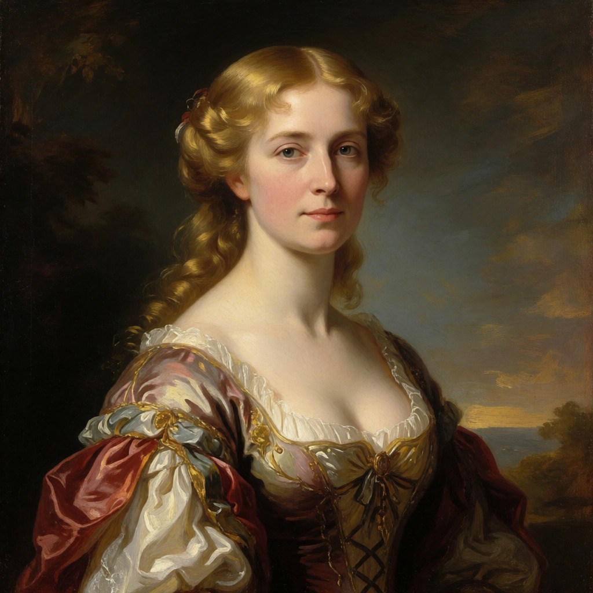

# Framework for automating Krea 2 Prompting

This is all very much tuned for my personal rig, but it 'works for me'. 

Hardware / Software used:
* AMD RADEON 9060 XT (16 GB)
* Ryzen 5 3600X
* 32 GB system memory
* 500 GB NVRAM SSD
* Ubuntu 24.04.5
* ROCM 10.0
* Docker with Compose and Model Runner installed
* Python 3.12
* uv

# Running
1. Install your LLM of choice into docker model runner
   ```
   mkdir -p gguf-models
   uvx hf download --local-dir gguf-models \
     --include gemma-4-12b-it-IQ4_NL.gguf \
     --include mmproj-F16.gguf \
     unsloth/gemma-4-12b-it-GGUF
   docker model package \
     --gguf `/bin/pwd`/gguf-models/gemma-4-12b-it-IQ4_NL.gguf  \
     --mmproj `/bin/pwd`/gguf-models/mmproj-F16.gguf \
     local/gemma-4
   ```
1. Download the Krea-2 model files
   ```
   mkdir -p comfyui-models/diffusion_models
   uvx hf download --local-dir comfyui-models \
     --include "diffusion_models/krea2_turbo_int8_convrot.safetensors" \
     --include "loras/*" \
     --include "text_encoders/qwen3vl_4b_fp8_scaled.safetensors" \
     --include "vae/*" \
     Comfy-Org/Krea-2
   ```
1. Create an `.env` file with your user id, group id, and the path of the model directory. 
   ```text
   UID=1000
   GID=44
   MODEL_DIR=./comfyui-models/
   ```
1. Build and run the comfy image and install the requirements and script to the venv
   ```
   docker compose build comfy
   docker compose up -d comfy
   uv venv 
   uv pip install -e .
   ```
4. Run the script to make an image
   ```
   uv run gen_from_llm --free-comfy --free-model --max-tokens 4096 \
     A renaissance portrait of a blonde 40 year old in a Victorian dress
   ```
   
# Bugs
1. The output folder images are owned by root. You'll have to use `sudo chown` to access them outside of the ComfyUI web interface

# Licence
This code is public domain. Don't bother giving me credit. All the training data for these models are stolen.